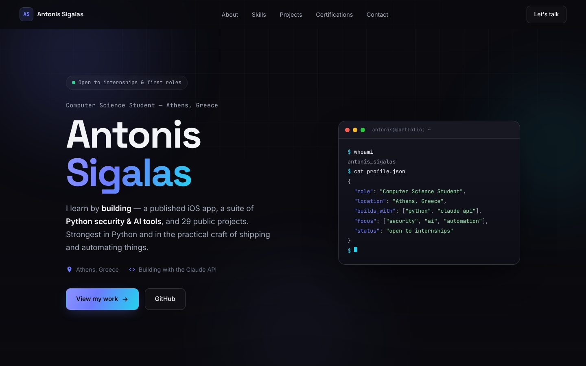
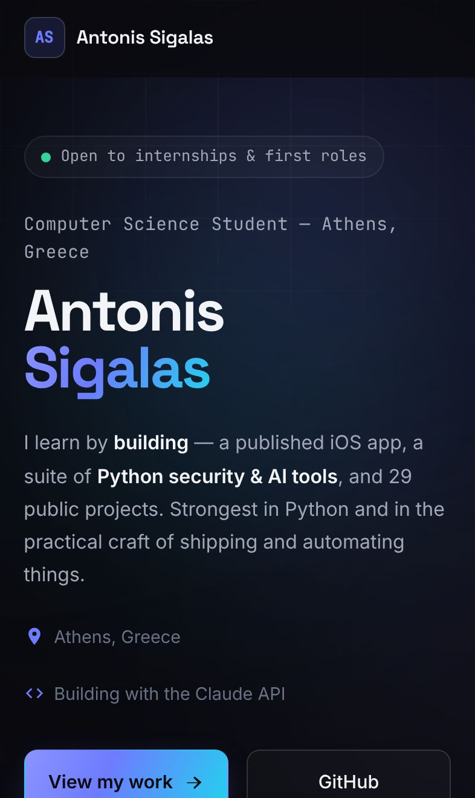

<div align="center">

# Antonis Sigalas

**Computer science student in Athens, Greece.<br>I learn by building things and shipping them.**

[](https://antoniossigalas.com)
[](https://pages.github.com/)
[](#run-it-on-your-computer)

[Website](https://antoniossigalas.com) · [GitHub](https://github.com/antwnakys) · [LinkedIn](https://www.linkedin.com/in/antonis-sigalas-836109335/) · [Email](mailto:dev@antoniossigalas.com)

<br>


&nbsp;


</div>

<br>

## What this is

This is the code for my personal website. It shows who I am, what I can do, and what I have built. You can see it live at **[antoniossigalas.com](https://antoniossigalas.com)**.

| Section | What you find there |
| --- | --- |
| **About** | A short story about me and how I learn |
| **Skills** | Python first, then JavaScript, AI with the Claude API, automation and security basics |
| **Projects** | My iPhone app [Grip OBD](https://apps.apple.com/app/grip-obd/id6801558613), my own email server, and my best GitHub projects |
| **Certifications** | My Anthropic courses and English certificates |
| **Contact** | Email, GitHub and LinkedIn |

## Why it is built this way

- **Fast.** The whole site is three files: one HTML page, one CSS file and a little JavaScript. There is no framework, so the page loads quickly, even on a slow phone.
- **Simple to change.** You don't need to install anything or run a build. You edit a file, and that's it.
- **Works on every screen.** The layout fits phones down to 320 pixels wide, tablets and large screens.
- **Calm when you need it.** If your device asks for less motion, the scroll animations turn off.

> [!NOTE]
> The look is dark and calm on purpose. Big moving backgrounds look nice, but they made slow laptops lag, so I removed them. The soft glow you see does not move.

## Run it on your computer

You only need Python, which most computers already have.

```bash
git clone https://github.com/antwnakys/Antonios_Sigalas.git
cd Antonios_Sigalas
python3 -m http.server 8000
```

Then open **http://localhost:8000** in your browser.

> [!TIP]
> Any simple web server works, for example `npx serve`. You can also open `index.html` straight from your files, but a server is closer to the real site.

## Change the content

| I want to change… | Open this file |
| --- | --- |
| Text, projects, certificates or links | `index.html` |
| Colors, fonts, sizes or spacing | `styles.css` |
| Scroll effects or the menu highlight | `main.js` |

The main colors live at the top of `styles.css`, so you can change the whole look in one place:

| Name | Value | Used for |
| --- | --- | --- |
| `--bg` | `#0a0a0f` | Page background |
| `--accent` | `#6d7cff` | Links, buttons and highlights |
| `--grad` | indigo to cyan | The name and the main button |

> [!IMPORTANT]
> To add a new section, do three things. First, give the section an `id` in `index.html`. Next, add that `id` to the `sections` list in `main.js`. Finally, add a menu link with `data-nav` in the header. If you skip a step, the menu won't highlight the new section.

## How it goes live

GitHub Pages hosts the site from the `main` branch. The `CNAME` file connects it to the domain antoniossigalas.com. When a change lands on `main`, the live site updates in one or two minutes.

> [!NOTE]
> Browsers may keep the old CSS and JavaScript for up to 10 minutes. If you don't see a change, reload the page without the cache (Ctrl+Shift+R, or Cmd+Shift+R on a Mac).

> [!WARNING]
> Anyone can download every file on `main` from the live site. Never commit private files, backups or zip files.

## Files

```text
.
├── index.html   all the content, on one page
├── styles.css   the design: colors, fonts and layout
├── main.js      small extras: scroll effects, menu highlight, progress bar
├── docs/        the screenshots in this README
├── CNAME        the custom domain for GitHub Pages
└── CLAUDE.md    notes for the AI coding assistant I use (Claude Code)
```

## Contributing

This is my personal website, so I don't add features from other people. However, did you find a typo or a broken link? Please open an issue or a pull request. Before you send a change, check it at phone size and on a large screen.

## Contact

I'm open to internships and first roles. The best way to reach me is email: **[dev@antoniossigalas.com](mailto:dev@antoniossigalas.com)**. You can also find me on [GitHub](https://github.com/antwnakys) and [LinkedIn](https://www.linkedin.com/in/antonis-sigalas-836109335/).

<div align="center">
<br>
<sub>Made in Athens · HTML, CSS and a little JavaScript</sub>
</div>
